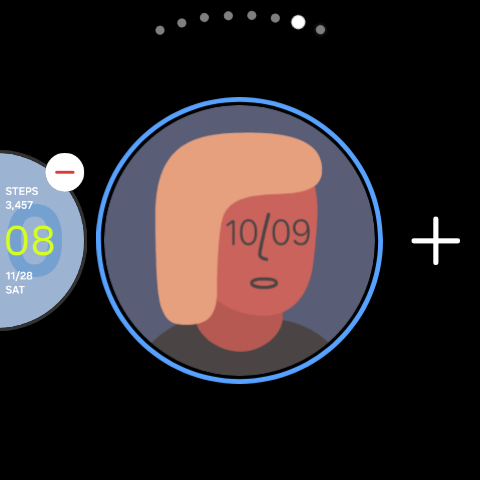

# Galaxy Watch 表盘

## 彩虹光辉 Pride Radiance

适用于支持 WFF 4 的 Wear OS 6 或更新版本。安装后在手表的表盘选择器中选用；在系统编辑页可选 I–V 五组配色。名称和配色辅助说明使用固件的本地化资源。

十个数字的几何与纹理坐标取自 24S132 固件。默认配色沿轮廓播放 64 帧光流。flow.py 对应 plumeriaFragmentShader 的循环位置、平滑衰减及颜色混合，并参考 bloomCompositeFragment 处理光晕。initLayerAndInstanceStructs 中的长度初始化为 0.30 + 0.25 × 随机值，步进范围按 30 帧基准为 0.0015–0.0024。移植版将亮屏光流预先渲染为 WFF 动画资源，初始相位、循环闭合、光晕滤波与圆屏排版为适配值。

[下载彩虹光辉 1.3](https://github.com/Charlie3xtra/galaxy-watch-faces/releases/download/pride-radiance-v1.3/PrideRadiance-1.3.apk) · [默认配色动态预览](PrideRadiance/flow-preview.webp) · [同时间对照](PrideRadiance/comparison-1.3.png)

## 艺术家 Artist

在支持 Watch Face Push 的 Wear OS 6 或更新版本手表上安装 APK，并打开一次。首次替换当前表盘时，按 Wear OS 提示确认。首次使用从安装器点「打开」。艺术家仅在表盘选择器中展示，应用抽屉中没有图标。点按可换脸，距离上次换脸超过一小时后再次亮屏也会换脸。息屏显示同一张脸的轮廓。

[下载艺术家 4.5](https://github.com/Charlie3xtra/galaxy-watch-faces/releases/download/artist-v4.5/Artist-4.5.apk) · [固件素材与索引](https://github.com/Charlie3xtra/watchos-face-assets)

Artist 目录含生成器、WFF 场景和本地 PowerShell 构建脚本。重新构建需要 Android SDK、Wear SDK、wearable complications 库、Push 验证工具及自己的签名密钥。应用通过前台服务监听亮屏，系统管理该服务的通知。

表盘与安装入口的名称采用固件 24S132 中 44 项语言与地区资源的官方译名。启用提示、通知和无障碍点按说明跟随系统语言。艺术家使用固件的十个手绘数字字形。
