# Galaxy Watch 表盘

## 彩虹线条 Pride Threads

| 亮屏 | 息屏 |
| :---: | :---: |
| <a href="PrideThreads/screenshots/active.png">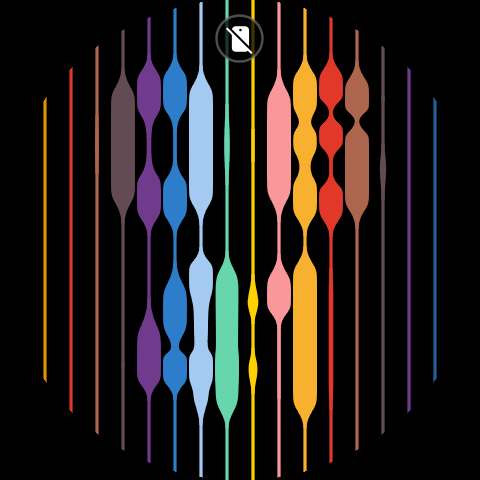</a> | <a href="PrideThreads/screenshots/ambient.png">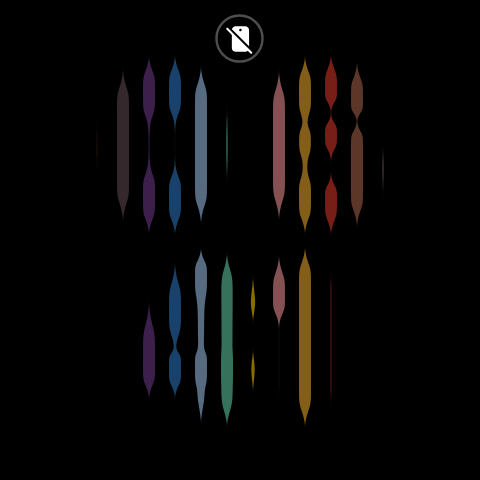</a> |

16 根彩线的宽度组成两行时间，点按一根线会触发局部振动。三星编辑器提供浅色和深色背景，表盘名称与背景名称跟随系统语言。支持 Wear OS 6 的 WFF 4 表盘选择器。

[下载彩虹线条 1.1](https://github.com/Charlie3xtra/galaxy-watch-faces/releases/download/pride-threads-v1.1/PrideThreads-1.1.apk) · [浅色编辑页](PrideThreads/watch-editor.png) · [深色编辑页](PrideThreads/watch-editor-dark.png)

24S132 的 NTKLilypadFaceBundle 提供数字图集、数字起止位置、灰度到线宽的查找表，以及两组各 16 个 RGBA 值。生成器复用单色遮罩，并按每根线的位置着色。圆屏布局参照官方 10:09 图调整。点按和亮屏振动使用 WFF 的 TAP 与 ON_VISIBLE 播放预绘波形。原版的噪声、跨线物理传播、腕部运动与数码表冠连续输入尚未复现。息屏使用黑底、窄线和静止数字。

## 彩虹光辉 Pride Radiance

| 亮屏（1.10） | 息屏（1.4） |
| :---: | :---: |
| <a href="PrideRadiance/screenshots/active.png">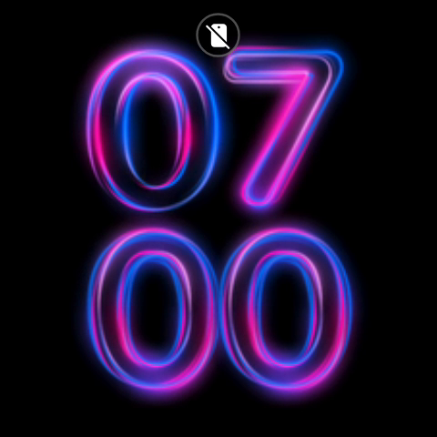</a> | <a href="PrideRadiance/ambient-1.4.png">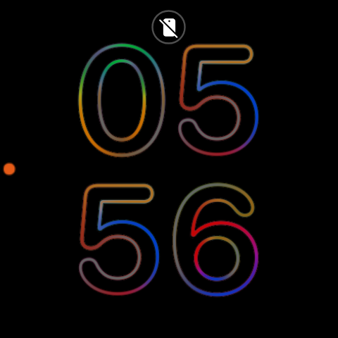</a> |

适用于支持 WFF 4 的 Wear OS 6 或更新版本。安装后在手表的表盘选择器中选用；在系统编辑页可选 I–V 五组配色。名称和配色辅助说明使用固件的本地化资源。

数字网格、纹理坐标和五组配色来自 watchOS 24S132 固件。五组配色的光流均按各自的色表和混合参数绘制，在 32 秒内经过 32 个关键位置，Wear OS 在相邻位置间按 30 帧/秒的目标插值。Apple 的 getDesiredFPSForDevice: 请求 30 或 60 帧/秒。圆屏版的排版、光流初始相位、循环、插值与光晕滤波经过适配。

息屏按各配色的 tritium 设置生成，使用专用颜色、色段长度、字形加宽和无外发光的静态绘制。相位与亮度映射仍是移植值，尚无同机同刻的 Apple 实拍校准。

[下载彩虹光辉 1.10](https://github.com/Charlie3xtra/galaxy-watch-faces/releases/download/pride-radiance-v1.10/PrideRadiance-1.10.apk) · [紫色光晕修正前后对照](https://github.com/Charlie3xtra/galaxy-watch-faces/releases/download/pride-radiance-v1.7/purple-compare-1.7.png) · [配色 II–V 动态对照](https://github.com/Charlie3xtra/galaxy-watch-faces/releases/download/pride-radiance-v1.5/colorways-II-V-1.5.mp4) · [Galaxy Watch 息屏实拍截图](PrideRadiance/ambient-1.4.png)

1.10 使用一秒线性渐变在完整画面之间过渡。保留系统双色圆点、五组配色和每轮 32 个关键位置。亮屏光场纹理使用预乘透明度缩放，WFF 内存检查通过。

## 艺术家 Artist

| 亮屏 | 息屏 |
| :---: | :---: |
| <a href="Artist/screenshots/active.png">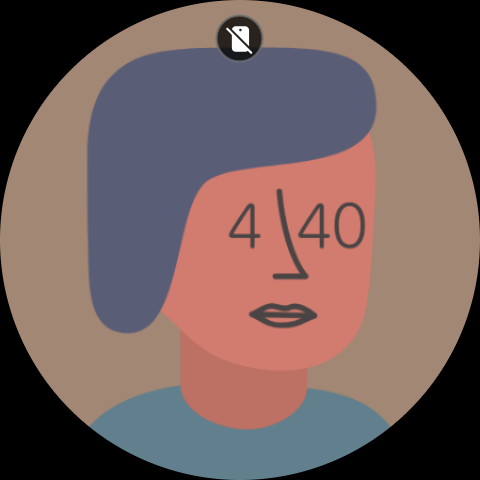</a> | <a href="Artist/screenshots/ambient.png">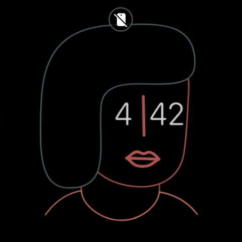</a> |

在支持 Watch Face Push 的 Wear OS 6 或更新版本手表上安装 APK，并打开一次。首次替换当前表盘时，按 Wear OS 提示确认。首次使用从安装器点「打开」。艺术家仅在表盘选择器中展示，应用抽屉中没有图标。点按可换脸，距离上次换脸超过一小时后再次亮屏也会换脸。息屏显示同一张脸的轮廓。

[下载艺术家 4.5](https://github.com/Charlie3xtra/galaxy-watch-faces/releases/download/artist-v4.5/Artist-4.5.apk) · [固件素材与索引](https://github.com/Charlie3xtra/watchos-face-assets)

Artist 目录含生成器、WFF 场景和本地 PowerShell 构建脚本。重新构建需要 Android SDK、Wear SDK、wearable complications 库、Push 验证工具及自己的签名密钥。应用通过前台服务监听亮屏，系统管理该服务的通知。

表盘与安装入口的名称采用固件 24S132 中 44 项语言与地区资源的官方译名。启用提示、通知和无障碍点按说明跟随系统语言。艺术家使用固件的十个手绘数字字形。

## X-Large · 大文字

| 纯时间 | 电池组件 |
| :---: | :---: |
| <a href="XLarge/screenshots/active.png">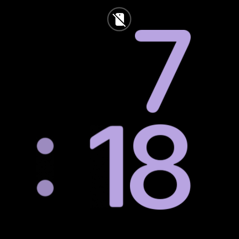</a> | <a href="XLarge/screenshots/battery.png">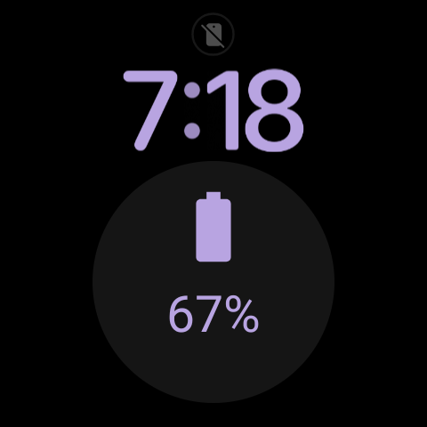</a> |

[下载大文字 1.3](https://github.com/Charlie3xtra/galaxy-watch-faces/releases/tag/xlarge-1.3)。默认两行纯时间。选择一个组件后，时间连同冒号移到顶部一行，组件占据下方的大圆区。圆屏比例参考 [Apple Watch 使用手册第 148 页](https://help.apple.com/pdf/watch/9/en_US/apple-watch-user-guide-watchos9.pdf#page=148)。

The default lavender and three numeral silhouettes were sampled from the Apple gallery image. The other digits use the closest measured SF Compact Rounded weight from build 24S132. The 26 additional solid colors use firmware catalog components. Round-screen spacing and ambient dimming are adaptations. Apple provider graphics, seasonal palettes, color sliders and alternate numeral scripts are outside this release. Build the included Android resources directly with XLarge/build.ps1. Regeneration additionally needs Pillow, NumPy, and the extracted 24S132 directory structure referenced in generate.py.

## 双行数字 · Numerals Duo

| 彩虹亮屏 | 彩虹息屏 |
| :---: | :---: |
| <a href="NumeralsDuo/screenshots/active.png">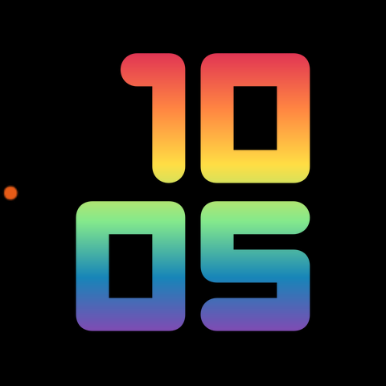</a> | <a href="NumeralsDuo/screenshots/ambient.png">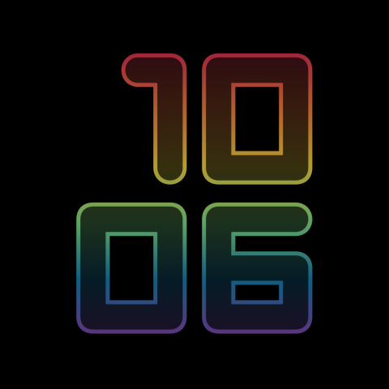</a> |

[下载 1.1](https://github.com/Charlie3xtra/galaxy-watch-faces/releases/tag/numerals-duo-1.1)。使用 24S132 固件表盘程序内嵌的 Tokyo 和 Tokyo Outline 字形。原生编辑器支持三套数字、实心 / 混合 / 空心样式与 62 种配色。另有彩虹选项。新版默认使用从上到下贯穿两行的六色渐变，原官方预览的紫色组合仍可选。渐变取自 24S132 的 NTKPrideColorUtils，息屏叠加 Tokyo Outline 并降低填充强度。直接运行 NumeralsDuo/build.ps1 可用现成资源构建。

## Nike 地球 · Nike Globe

| 亮屏 | 息屏 |
| :---: | :---: |
|  |  |

[下载 1.1](https://github.com/Charlie3xtra/galaxy-watch-faces/releases/tag/nike-globe-1.1)。WFF 4 单 APK。亮屏跟随当前秒数显示固件中的 Globe_00 至 Globe_59，息屏切换到独立 Globe 网格。上下两行使用内嵌 Vivaldi 字体的小时和分钟连字。提供 23 种固件配色与一个参考官方预览图制作的黑底珊瑚色方案。1.1 移除四角组件，网格、时间和标志整体放大 20%。中央标志为装饰。APK 可直接从 NikeGlobe/build.ps1 构建，重新生成资源需要 Pillow、fontTools 和 24S132 提取目录。

## 流动 · Flow

| 亮屏 | 息屏 |
| :---: | :---: |
|  | <a href="Flow/screenshots/ambient.png">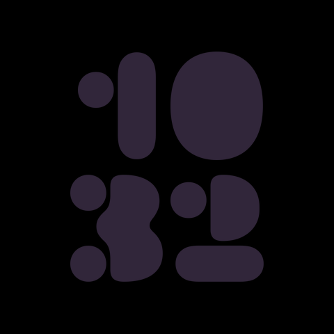</a> |

[下载流动 1.3](https://github.com/Charlie3xtra/galaxy-watch-faces/releases/tag/flow-1.3)。使用 24S132 固件内嵌的 ADT Murano I、II 字体。编辑器支持两套字样、背景开关、官方预览取色方案及七组基于固件季节色的配色。背景与数字共用手腕倾角和纹理坐标，字形边缘按轮廓方向取样相邻颜色。1.2 从官方预览分别采样默认配色的背景和玻璃色阶，加宽笔画边缘的折射范围，并收窄轮廓高光。1.3 修正了季节配色玻璃亮部过曝，[午夜蓝真机截图](Flow/screenshots/blue.png)。Apple Metal 的逐像素折射、流体运动及全部原生色阶尚未复现。亮屏图摄于 1.2，息屏图摄于沿用相同息屏绘制方式的 1.0。Galaxy 息屏采用黑底低亮静态数字，Apple 原版息屏的最终配色仍待核实。构建现有资源使用 Flow/build.ps1，重新生成需要 Pillow、NumPy、固件提取目录和官方预览图。

## 流转 · Flux

| 亮屏 | 息屏 |
| :---: | :---: |
| 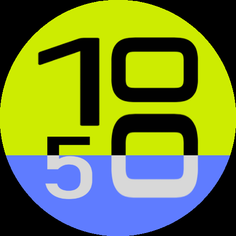 |  |

[下载流转 1.1](https://github.com/Charlie3xtra/galaxy-watch-faces/releases/tag/flux-1.1) · [Galaxy Watch 跨分钟实录](Flux/screenshots/minute.mp4)。动态模式按 24S132 的 14 组背景色和字色循环，索引由年内日序、显示小时和分钟决定。三套数字的 12/24 小时路径来自固件，按四个关键形状、0.25 秒时长及原缓动曲线采样。少数路径指令数量或类型不同的字形在对应阶段切换轮廓。录屏中实际形变约每 100 毫秒更新一次。息屏采用本分钟静态原字形和低亮灰色。构建现有资源使用 Flux/build.ps1；重新生成时先运行 Flux/dolomite.py，再运行 Flux/generate.py，需要 24S132 提取文件、原工作区资料、NumPy、Pillow 和 fontTools。

## Nike 混合 · Nike Hybrid

| 亮屏 | 息屏 |
| :---: | :---: |
| 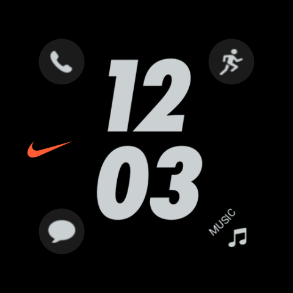 | 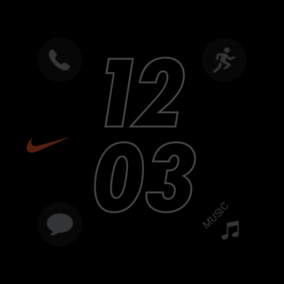 |

[下载 Nike 混合 1.3](https://github.com/Charlie3xtra/galaxy-watch-faces/releases/tag/nike-hybrid-1.3)。默认双行数字采用 24S132 固件内嵌的 Victory Italic 和 Nike Hybrid 专用 Swoosh，息屏使用 Victory Outline Italic。提供 12 组配色、数字与两种指针样式、全屏和圆形刻度盘。四角可单独配置专用图案或关闭，默认对应电话、训练、信息和音乐。电话、跑者、气泡和音符取自官方预览，闹钟和心率图标来自固件。日期、电量按实时数据绘制。系统组件可替换角位显示，底部弧形文字槽默认留空。1.2 加大四角图案，音乐按圆弧排字，心率、电量、天气状况、气温和紫外线各有独立排版。1.3 将组件移到四角对角线，新增计时预设、月相与海拔入口。三星计时器和海拔数据的实测限制见核对表。[逐项固件核对](NikeHybrid/角位核对.md)。数字版以 Apple 官方预览为依据，指针、扇形遮罩、刻度及息屏亮度为 Galaxy 圆屏适配。使用 NikeHybrid/build.ps1 构建现有资源。

## Nike 回弹 · Nike Bounce

| 点按回弹（手表实录） | 息屏 |
| --- | --- |
|  | 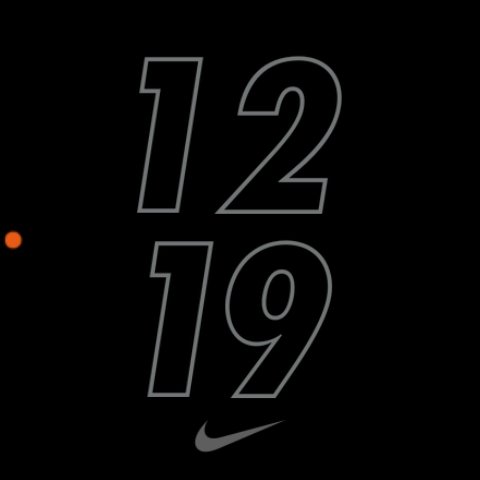 |

[下载 Nike 回弹 1.1](https://github.com/Charlie3xtra/galaxy-watch-faces/releases/tag/nike-bounce-1.1) · [亮屏截图](NikeBounce/screenshots/active.png)

以 24S132 的 NTKMagmaFaceBundle、Victory 字体和 Nike 图标为依据。原版使用 Metal 弹簧网格，本版用预计算的局部位移纹理近似点按和换分钟的回摆，并用 WFF 加速度变换响应腕动。十组单色支持切换背景和多语言名称。点按响应以数字为单位，三星系统会叠加触摸反馈。机械表冠未实现。息屏使用静态描边。真实步伐和抬腕的力度尚未与 Apple Watch 真机校准。

1.1 将亮屏、息屏和选择器中的数字及标志以圆心为基准等比放大 9%。[新版尺寸预览](NikeBounce/res/drawable-nodpi/preview.png)。

## Hermès 航海 · Hermès Maritime

| 正常读时 | 系统倒计时 | 息屏 |
| --- | --- | --- |
| 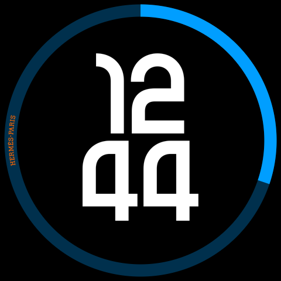 | 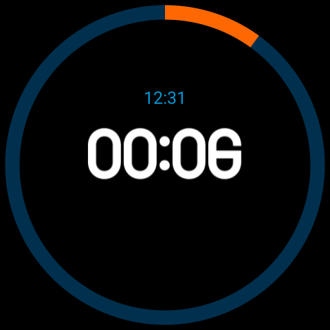 | 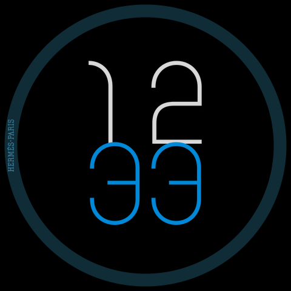 |

[下载 Hermès 航海 1.1](https://github.com/Charlie3xtra/galaxy-watch-faces/releases/tag/hermes-maritime-1.1) · [系统计时器暂停实拍](HermesMaritime/screenshots/paused.png)

单 APK。安装后打开一次登记表盘。左侧字标沿秒圈弯曲。开启手表的通知读取授权后，直接使用三星系统计时器；表盘会在双行时钟上方显示系统通知中的剩余时间，暂停时显示暂停标记，取消后恢复蓝色秒圈。橙圈表示当前一分钟的剩余秒数。没有独立计时设置页。通知由设备本地处理，仅解析三星计时器数据。在测试手表上未找到可从应用启动的通知授权设置页面；已授权的测试设备日常使用无需调试。若三星更新其计时通知格式，可能需要更新适配。
## 人像 · Portraits

| 手表亮屏实拍 | 表盘预览 |
| --- | --- |
| 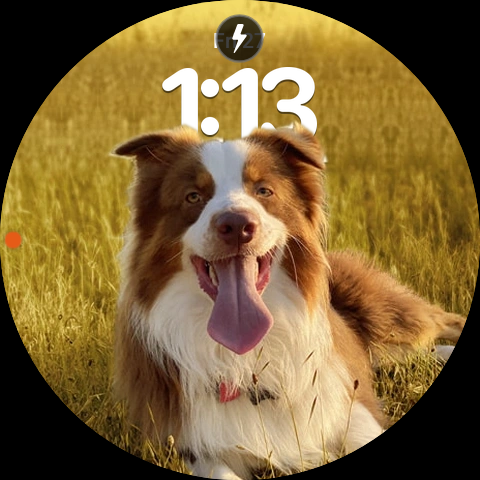 | 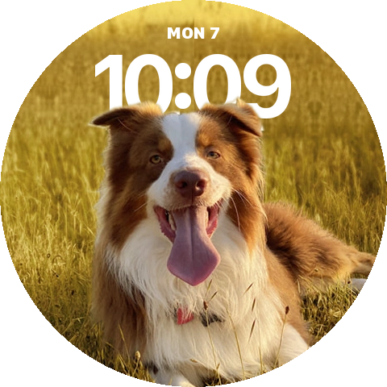 |

[下载人像 1.1](https://github.com/Charlie3xtra/galaxy-watch-faces/releases/tag/portraits-1.1)。只内置一张小狗照片，使用三种字体。小狗的前景遮挡根据 [Apple 官方宣传图](https://www.apple.com.cn/newsroom/images/product/watch/standard/Apple-watchOS-9-Watch-Portraits-face-220912_inline.jpg.large_2x.jpg) 制作，原图上的固定时间已移除。自定义相册使用 Wear OS 原生多选照片配置，照片上方显示实时时钟，点按换图。手机端选图和裁切尚未实测。

## 加州 · California

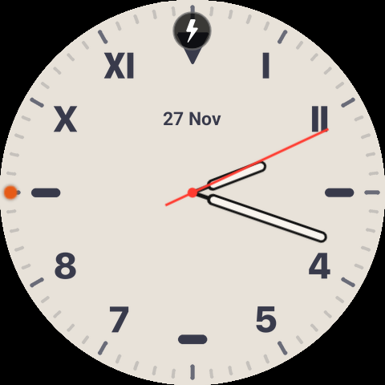

[下载加州 1.1](https://github.com/Charlie3xtra/galaxy-watch-faces/releases/tag/california-1.1) · [圆形亮屏与息屏对照](California/圆形盘面核对.md)。1.1 默认使用圆形奶白配色，上图为 1.0 实拍，数字使用 watchOS 24S132 加州表盘内嵌的 SF Compact Numerals Bold。提供六种数字样式、六款配色和一个可更换的短文本组件，默认显示日期。指针长度和刻度半径已适配 Galaxy 圆屏。息屏采用黑底、保留时分针并隐藏秒针，配色含移植取值。

## 轮廓 Contour

| 亮屏 | 息屏 |
| :---: | :---: |
| 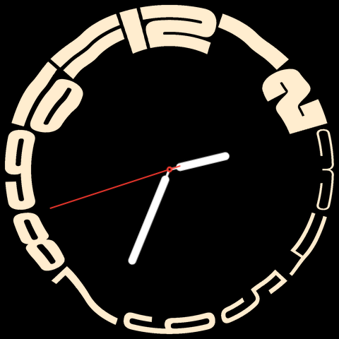 | 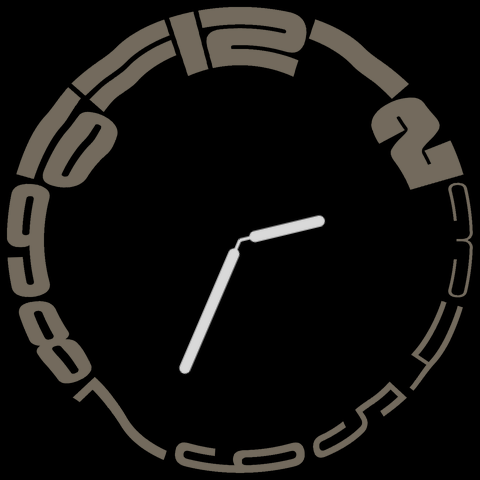 |

从 watchOS 24S132 的 NTKProteusFaceBundle 读取 Neptune 常规及圆体字形，按小时计算字重，再将原有矩形数字带映射到圆屏。整点前两秒使用 23 档字重过渡。提供六款配色、彩色盘底、上方文字和下方圆形组件。息屏黑底来自固件，数字亮度按 Galaxy 屏幕适配。Apple 的点按波动和表冠展开尚未移植。两图均来自 Galaxy Watch。

[下载轮廓 1.2](https://github.com/Charlie3xtra/galaxy-watch-faces/releases/download/contour-1.2/Contour-1.2.apk) · [双组件真机截图](Contour/screenshots/active-1.2.png) · [常规字形预览](Contour/screenshots/style_sharp.png) · [圆体字形预览](Contour/screenshots/style_soft.png)
